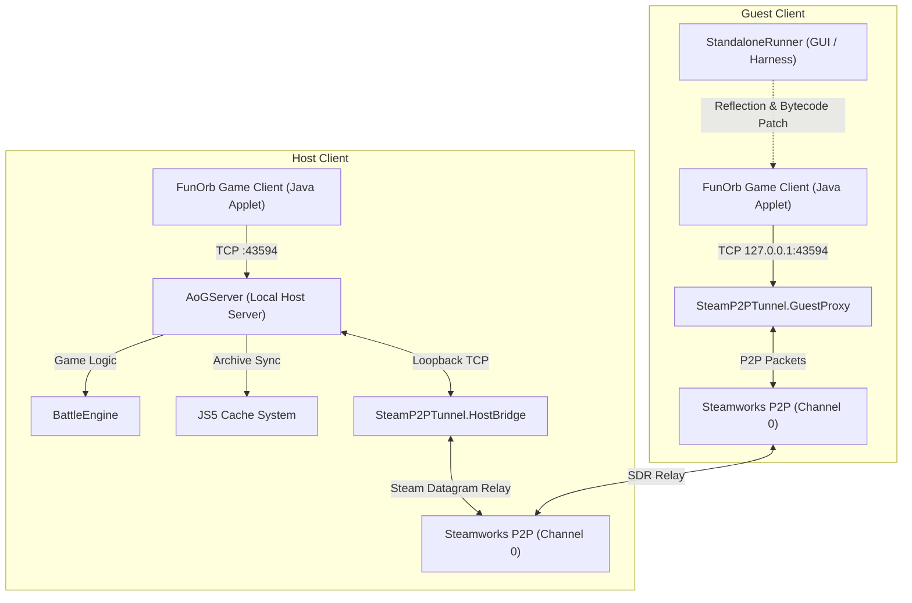
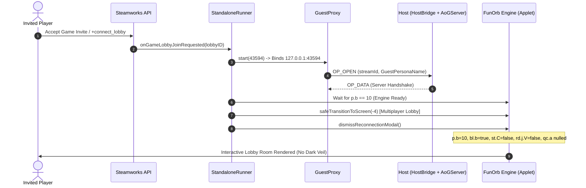

# Armies of Gielinor — Architecture, Protocols & Symbol Dictionary

This document serves as the canonical technical reference for developers and AI assistants working with the **Armies of Gielinor (AoG)** revival codebase.

---

## 1. System Architecture Overview

---

## 2. Rosetta Stone: Obfuscated Jagex Symbols Dictionary

The FunOrb client engine bytecode was obfuscated by Jagex using Zelix KlassMaster (ZKM). The table below maps every obfuscated class, field, and method used or managed by the launcher harness to its actual purpose:

### Core Engine State & Navigation

| Obfuscated Symbol | Type | Real Name / Purpose | Permitted Values & Notes |
| :--- | :--- | :--- | :--- |
| `jt.a` | `int` | **Active Screen ID** | `-2` = Engine loading & cache verification `-1` = Main Menu `-4` = Multiplayer Lobby / Room `0` = In-Game Battle Viewport |
| `bv.a(bool, int, int, int)` | `Method` | **Screen Transition Method** | Parameters: `(boolean bl, int targetScreen, int unk=1, int currentScreen)`. Must be invoked under `appletHolder[0]` synchronization lock. |
| `p.b` | `int` | **Engine Connection & Boot State** | `0..9` = Initializing subsystems. `10` = Connected / Engine Active / OK. `11` = Disconnected / Reconnecting. When `11`, the engine paints the translucent black veil and drops all user input! |
| `bl.b` | `boolean` | **Session Validity Flag** | `true` = Initial normal login session. `false` = Reconnection session (set in `wf.java:331`). When `false`, `qv.j(-11)` returns `true` and causes `er.b(-11)` to repeatedly trigger `p.b = 11`. Must be restored to `true`. |
| `st.C` | `boolean` | **Reconnection Active Flag** | Set to `true` by `ed.a(-89)`. If `true`, internal socket ticks in `wf.h` trigger `er.b(-11)` to force `p.b = 11`. Must be cleared to `false`. |
| `hi.i` | `Object` (`ep`) | **Screen Transition Fade** | Instance of the screen transition animator. If non-null, a black fade cutscene is currently playing. Must be set to `null` to abort stuck fades. |
| `ep.e` | `double` | **Cutscene Fade Speed** | Speed multiplier of active screen fade. Setting to `5.0` rapidly concludes the fade animation. |
| `tq.a` | `volatile boolean` | **Canvas Resize Trigger** | When set to `true`, tells the software rasterizer to re-allocate its internal `int[]` pixel buffer to match the new `Canvas` dimensions. |

### Modal Dialog, Disconnection Veil & Lobby Controls

| Obfuscated Symbol | Type | Real Name / Purpose | Permitted Values & Notes |
| :--- | :--- | :--- | :--- |
| `rd.j` | `Object` (`ic`) | **Multiplayer Room Interface** | Holds the active multiplayer lobby room UI instance. |
| `bc.a` | `Object` (`ic`) | **Alternate Room Interface** | Holds the alternate/modal room UI instance when `gk.H` is true. |
| `ic.V` | `boolean` | **Room Modal Interaction Lock** | Initialized to `true`. While `true`, `ic.java:1667` executes `if (this.V) return -1;`, discarding all clicks in the lobby. Must be cleared to `false`. |
| `ic.j` | `int` | **Room Transition Animation Timer** | Tick counter for modal slide animations. Must be reset to `0` when unlocking. |
| `ac.n` | `boolean` | **Disconnection Veil Flag** | Set to `true` by `dj.a((byte)-127)` when a socket drops. Draws a semi-transparent black overlay across the entire canvas. |
| `qc.a` | `Object` (`ro`) | **Active Modal Dialog** | Holds the active modal window instance. When non-null, captures all mouse input. Must be cleared to unfreeze the UI. |
| `ro.b(boolean)` | `Method` | **Modal Active Toggle** | Invoked with `true` to set `this.L = false`, deactivating the modal's input interception loop. |
| `tc.d(int)` | `Method` | **Modal Event Dispatcher** | Invoked with opcode `37` to signal clean modal dismissal and garbage collection. |
| `rl.C` | `Object` | **Root Widget Container** | The top-level GUI container in the widget tree. Modal focus must be removed via `rl.C.j(-102)` and `rl.C.k(0)`. |
| `pl.A`, `fh.i`, `se.f` | `boolean` | **Network Error Flags** | Auxiliary connection error flags. Must all be cleared to `false` during modal dismissal. |
| `ed.a(int)` | `Method` | **Reconnection Check Function** | Evaluates `11 == p.b`. Line 78 in `ArmiesOfGielinor.a(B)V` aborts all mouse and keyboard processing if `ed.a` returns `true`. |
| `bl.a(boolean, int)` | `Method` | **Veil Render Function** | Called at line 1107 in `ArmiesOfGielinor.a(I)V` if `ed.a(-89)` is `true`. Invokes `tq.a` to paint `qn.b(0, 0, w, h, 0, 192)` ($\alpha=192$ dark overlay). |

---

## 3. Network Protocols & Opcode Tables

### A. Steam P2P Multiplexing Protocol (`SteamP2PTunnel`, Channel 0)

All game traffic between Host and Guest is multiplexed over Steam P2P using 4 frame opcodes:

| Opcode | Hex | Name | Payload Structure | Description |
| :---: | :---: | :--- | :--- | :--- |
| **1** | `0x01` | `OP_OPEN` | `[byte: 1][int: streamId][byte: nameLen][byte[]: name]` | Guest requests opening a new virtual TCP stream to Host's `AoGServer`. |
| **2** | `0x02` | `OP_DATA` | `[byte: 2][int: streamId][byte[]: rawTCPData]` | Encapsulates raw game socket payload bidirectionally. |
| **3** | `0x03` | `OP_CLOSE` | `[byte: 3][int: streamId]` | Signals that the specified virtual stream has closed. |
| **4** | `0x04` | `OP_PING` | `[byte: 4]` | Heartbeat packet to warm up and maintain Steam SDR NAT routes. |

---

### B. FunOrb Engine Game Protocol (`AoGServer` & `BattleEngine`)

| Opcode | Category | Description |
| :---: | :--- | :--- |
| **15** | JS5 Cache | Handshake for downloading game assets and archive indices (`main_file_cache.dat2`). |
| **64** | Match Setup | Broadcasts match configuration (player slots, teams, factions: Saradomin, Zamorak, Guthix, etc.). |
| **67** | Turn State | Synchronizes current active player turn, remaining turn ticks, and timer status. |
| **68** | Battle Action | In-game action events: unit movement, combat attack animation, spell cast, terrain capture. |
| **69** | Match Over | Concludes battle, declaring victory or defeat per player slot. |
| **77** | Army Loadout | Transmits player's selected army card deck, hero selection, and unit points budget. |

---

## 4. File System & Persistence Map

| Path | Purpose | Format |
| :--- | :--- | :--- |
| `%USERPROFILE%\.armiesofgielinor\player.properties` | Campaign progress, volume, username, resolution. | Java Key-Value Properties |
| `%USERPROFILE%\.armiesofgielinor\caches\armiesofgielinor\` | Persistent game cache store (`main_file_cache.dat2`). | Jagex JS5 Binary Archive |
| `%USERPROFILE%\AppData\Local\ArmiesOfGielinor_App\` | Standalone `.exe` payload extraction cache. | Application Directory |
| `app/ArmiesOfGielinor.jar` | Core game executable containing launcher, server, and client. | Standard JAR Archive |
| `steam_appid.txt` | Steamworks configuration (AppID `480` = *Spacewar*). | ASCII Text |

---

## 5. Screen Transition & Join Lifecycle Sequence

---

## 6. Developer Guidelines for Future Modifications

1. **Do not recompile obfuscated classes directly**:
   Always use bytecode instrumentation (via `javassist` or `asm` in `SurgicalPatcher.java`) or external reflection in `StandaloneRunner`. Recompiling CFR decompiler output breaks obfuscated type-casts and opaque predicates.
2. **Always synchronize screen transitions**:
   Calls to `bv.a()` must be enclosed within `synchronized (appletHolder[0])` to prevent race conditions with the 50 FPS game render loop.
3. **Always call `dismissReconnectionModal()` after socket resets**:
   Any socket disconnect drops `ac.n = true` and creates an input-blocking modal veil (`qc.a`). Clearing it requires setting `p.b = 10`, `bl.b = true`, `st.C = false`, `rd.j.V = false`, and releasing widget tree focus.
